

# Fake Players

### Player look-alikes that mine, chop, guard, and haul - for you.

## What is it?

Entities that look **exactly** like real players - auto-grabbed skins, armour, full inventories, the lot. Bond one to yourself, give it a job, and it gets to work.

## The Fake Player

- **Looks like a player** - real model with a skin grabbed from any username (or URL / the trending list); slim & classic.
- **Acts like one** - wanders, sits, wears armour, holds items, chats, fights back. With nothing to do it watches you, and at night it finds a bed (see [Idle fakes](#idle-fakes)).
- **Fights at range** - give it a bow, crossbow or trident and it keeps its distance, strafes and fires like a skeleton, shooting arrows from its own inventory.
- **Won't hurt its own side** - arrows, explosions and the rest miss you, your other fakes and your pets. It doesn't hit back if you hit it either.
- **Carries an inventory** - managed through its GUI.

## AI Jobs

A fake placed from an egg comes bonded to you and already on **Idle**. Shift + right-click it (or press your **Open Fake Player Menu** key, see below) → **AI**, then pick a job. One made with `/summon` or by another mod starts unbonded; press **Bond** first. Nobody can bond a fake that's already someone else's.

The GUI hands you markers (waypoint, region, chests); right-click to place them - the fake follows you while you do. Each job's menu shows only the markers it needs, and fakes visibly open the chests and barrels they work from.

| Job | Needs | Does |
| --- | --- | --- |
| **Idle** | waypoint (optional) | Walks to its waypoint, else waits. |
| **Follow** | bond | Sticks within 32 blocks, teleports if it lags behind. |
| **Guard** | patrol points | Patrols your points and attacks hostiles in range, at range if it is carrying a bow, crossbow or trident. Hold the Waypoint marker to edit points - right-click adds, sneak + right-click removes. |
| **Miner** | region + deposit | Strip-mines ore (`c:ores` by default) and banks the haul. Filter grammar and the on/off toggle are covered below. |
| **Lumberjack** | region (+ deposit) | Fells whole trees, replants, bonemeals; auto-collects drops. |
| **Courier** | source + deposit | Hauls matching items from one chest to another. Shares the Miner's filter. |
| **Fisherman** | waypoint + deposit | Sits at the water and casts a real bobber; banks the catch, swaps a fresh rod when one breaks, and uses your rod's enchantments. Accepts compatible modded rods and fish added to fishing loot. |
| **Farmer** | region + deposit | Tills a plot, waters it, plants any seed (modded too), bonemeals, then harvests and replants on a loop. |
| **Crafter** | table + source + deposit | Walks to a crafting table and lays out a recipe you teach it by hand; chain it onto another job's chest for a pipeline. |
| **Quartermaster** | storage pool | Owns a pool of marked containers, answers requests from your other fakes and from you, and sends Runners. Never leaves the storeroom. |
| **Runner** | none | Fetches a requested item from a Quartermaster's pool and delivers it. No fixed route and nothing to configure. |
| **Builder** | schematic + anchor + source (+ deposit) | Builds a structure file out of a supply chest. Several can share one build. See [Builder](#builder). |

Most working jobs have a **Stock** row too. Type what the fake should keep on it, e.g.
`minecraft:torch 64, minecraft:bread 16`, and hit Apply (eight items max). Whenever it falls short it
asks a Quartermaster for the rest and keeps working in the meantime.

### Requests: Quartermaster and Runner

A fake that runs out of something asks for more instead of just stopping. A **Quartermaster** owns a
storeroom and works out who can fill the request; a **Runner** does the carrying. Set one of each up:

- Set a fake to **Quartermaster** and press Mark on its Pool row. Right-click each chest or barrel to
  add it to the pool, and right-click a pooled one again to remove it. The marker is not used up, so
  one marker marks the whole storeroom. Vanilla furnaces and other sided containers cannot be pooled,
  and marking only one half of a double chest is enough. Modded storage works too, see
  [Modded storage](#modded-storage).
- Bond at least one fake as a **Runner**, owned by you and within `requestRadius` blocks (256 by
  default, about 16 chunks). The Quartermaster never walks, so with no Runner nearby nothing is
  delivered and it tells you so. The same radius decides which Quartermasters a waiting fake can
  reach, so a storeroom further than that is invisible to it.
- Start both. A Fisherman with no rod now asks for one and waits, and the rod arrives if the pool has
  one. If nothing can fill the request you are told **once** and the fake keeps waiting rather than
  unbonding itself.
- Ask for something yourself from the **Request** row on a Quartermaster. Press Browse to see
  everything the storeroom holds, then click an item: a click asks for a stack, sneak-click asks for
  one, ctrl-click asks for all of it. Asking again for more tops the request up instead of queuing a
  second one. Under the grid is what you currently have on order, with an x to call one off. The
  whole thing updates while you watch it.

Worth knowing:

- Only **your own** Quartermasters serve you: browsing a teammate's storeroom is refused.
- The nearest Quartermaster that actually **has stock** wins, so an empty storeroom standing closer
  does not shadow a full one.
- Items are matched by id, so a damaged or enchanted one already in the Runner's own inventory can be
  handed over in place of a fresh one from the pool. For the same reason Browse merges variants:
  three tools of different durability show as one icon with a count of three.
- A Runner holds what it is carrying, so you can see which ones are loaded from across the base.
  With nothing to carry it walks back to its Quartermaster rather than standing where it stopped.
- Re-jobbing a Runner mid-delivery leaves the goods in its inventory. Open it to take them back, or
  set it back to Runner and it returns them to the pool itself.
- If whoever asked has gone missing, the Runner tells you and hangs on to the goods. They go back to
  the pool once the request times out.
- Miners, Lumberjacks, Farmers and Fishermen ask for a new tool when theirs breaks, and carry on when
  it shows up. They're sent the best one in the pool that they can use (modded tools count). Worn-out
  ones are skipped.
- You get one message per problem. Anything sent while you were offline is waiting when you log in.

#### Crafting what the pool doesn't have

Say a fake wants a chest and the pool only has logs. The Quartermaster passes that to a **Crafter**,
which can go several recipes deep, uses whatever the pool already has and only makes the shortfall.
If even the logs aren't there you get a single message with everything that's missing.

You need a Crafter bonded to you with its table marked. Each one handles a single craft at a time.
`requestCraftTimeoutSeconds` is how long the Quartermaster waits on one before asking again.

### Builder

Give a Builder an `.nbt` structure file and a **Source** chest full of blocks and it puts the thing
up. It won't go and mine or craft anything itself. Keep the chest topped up with a Courier, or let it
ask a Quartermaster.

1. Set a fake to **Builder**, type the file name (no `.nbt`) into the **Plan** box and press Enter.
2. Press **Anchor** for an anchor marker and right-click a block. The build's corner sits against
   that face, facing the way you're looking. **Rot** turns it 90 degrees per click, **Mirror** flips
   it.
3. Mark the **Source** chest, plus a **Deposit** chest for leftovers and rubble if you want one.
   Start it.

It looks for the file in `schematics/` (Create's folder), then `schematics/uploaded/<your name>/`,
then `config/players/schematics/`. Other players' uploads are never searched. You can also give a
namespaced id like `minecraft:my_house` for something saved with a structure block.

Anything in the build area that shouldn't be there gets dug out and dumped in the deposit chest.
Chests and other blocks holding items are left alone, and the Builder stops and tells you where the
one in its way is. Fluids and blocks you can't get as an item are skipped (it says how many once).

Run short of something and it stops and names what it needs. With a Quartermaster around it asks for
it, which can end up with a Crafter making it. Without one it waits for you to restock the chest.
A few seconds after the items turn up it picks the build back up by itself.

Several Builders on the same file and anchor split it into strips between them. When one of them
dies or gets another job, its strip is free for the others.

Limits and caveats:

- The anchor can be at most 64 blocks from the Builder (`builderMaxAnchorDistance`). Files bigger
  than 32768 blocks of bounding box are refused (`builderMaxVolume`).
- Only the owner can change the plan or the anchor.
- It doesn't check land claims before breaking or placing. Neither do the Miner and Lumberjack.
- Waterlogged blocks go in dry unless there's already water there.

### Modded storage

Drawers, Sophisticated Storage barrels and other modded containers can now be marked as a source,
a deposit or part of a Quartermaster's pool. Anything a mod exposes through NeoForge's item handlers or Fabric's
transfer API counts. A drawer with 2,000 cobble in it reads as 2,000 and isn't full at 64, and a
locked or filtered one still rejects what it's meant to.

Be careful what you mark. A fake sees every slot it can reach as storage, machines included, and if
you mark a modded pulveriser as a deposit it will fill the input with cobble. That's deliberate, since
marking is always done by hand. To make fakes ignore some blocks entirely, add them to the
`#players:not_storage` block tag in a datapack (it's empty by default).

A drawer controller and its drawers might both get counted. Pool one or the other. Storage Drawers is
the only mod that's actually been tested in game so far.

### Fishing with modded rods

A Fisherman accepts rods using the vanilla rod class or common fishing tags. It catches items from
vanilla fishing loot, including fish added there by mods. Treasure still needs open water. Mods with
their own catch or tackle systems need a separate integration.

**Aquaculture**, on Forge and NeoForge, goes further. A Fisherman reads the tackle fitted to the rod
at a Tackle Box and fishes to it:

- the hook's luck, its chance of a double catch, and its chance of sparing the rod a point of durability
- bait, which is used up as it fishes
- the hook's own texture on the bobber, and a dyed fishing line's colour on the line
- lava, if you have the lava fishing addon and a hook that can take it. Put the waypoint by lava and it
  casts there, the bobber sits in it without burning, and the catch survives the trip back

The redstone hook's longer bite window makes no difference, because a fake never misses a bite. Tackle
systems belonging to other fishing mods need their own integration. Mods in the style of Fishing Real, which swap a catch for a live
entity when a real player reels in, hand a Fisherman the item instead, on every loader.

### Optional fishing mods

Aquaculture is supported on Minecraft 1.21.11 NeoForge. Its lava fishing addon is supported too. Both are optional.
Aquaculture is not available on Fabric.

River Fishing assembly and catches are available on the 1.21.1 branch.
They are not included in this branch.

Tide fishing and TACZ guns are only in the 1.20.1 and 1.21.1 builds. This build doesn't have them.

### Miner / Courier filter

The Miner and Courier both filter what they collect against one stored string, edited from the AI menu's Filter row:

- `<namespace>:<id>` - a specific item or block, e.g. `minecraft:diamond`.
- `#<namespace>:<tag>` - an item or block tag, e.g. `#c:ores`.
- Comma-separated for multiple tokens: `minecraft:diamond,#c:ores`.
- `*`, or a blank box - matches everything. The ON/OFF button next to Apply toggles this directly, and a blank box always means the filter is off (reopening the menu shows it that way too).

Miner defaults to `c:ores` when never set; Courier defaults to matching everything when never set, and the Filter row reflects that per job. Applying a filter does **not** reset quarry progress.

## Idle fakes

On Idle, or with its job stopped, a fake keeps an eye on things. Walk within about 8 blocks and it
turns to watch you. Come back after a while away and you get a wave. Other players get looked at too.

At night it goes to bed. It picks a free bed within 24 blocks, sleeps till morning and gets up early
if it's hurt or handed a job. Beds an online player respawns at are off limits. Bed claims are the
villagers' own, so a villager won't take a fake's bed (and a fake won't take a villager's). Fakes
aren't players and don't count towards skipping the night.

Right-clicking one with a bed still lays it down wherever it stands. Start a job and all of the above
stops at once.

### Speech bubbles

Anything a fake says appears over its head as well as in chat as a `<name> message` line. Messages
only meant for the owner stay in chat. To drop the chat copy set `speechBubblesReplaceChat` to `true`,
and to lose the bubbles set `speechBubbles` to `false`.

`speechVerbosity` decides how much they say:

- `off` - only what you asked for, like a named paper
- `quiet` (default) - plus problems you need to deal with
- `chatty` - plus progress, e.g. a Builder starting

A fake repeats the same line at most every 30 seconds.

### Status marks

A yellow **!** over a working fake's head means it's blocked, full or out of tools. A red **?** means
it should be working and hasn't made progress for a minute, or two for a Runner. Either one clears
when it gets going again.

## Riding

Boats, minecarts, Create seats and trains all work, as do seats from other mods. Hold any marker that
fake gave you and right-click what it should ride, within 16 blocks of it. For a Create seat you
click the seat block. Riding pauses its job until you pull it off with a stairs block (owner and ops
only, same as seating it).

Put one in a Create train's conductor seat and hand it a schedule like you would a villager, and it'll
drive the train.

## Chunk Anchor

Install a **Chunk Anchor** in a fake and the 3x3 chunks around it stay loaded wherever it goes. It keeps working after you leave.

Right-click your own fake with it. There's no taking it back out; it drops when the fake dies.

Recipe: echo shards in the corners, netherite ingots top and bottom, eyes of ender either side, Robot
AI in the middle.

- A dedicated server still pauses a minute after the last player leaves. Set
  `pause-when-empty-seconds=0` in `server.properties` if anchored fakes should carry on.
- Running `/forceload` on a chunk a fake already holds doesn't stick. It's released when the fake
  moves off.
- Server owners can turn every anchor off with `chunkAnchors: false` (players keep the items). The
  recipe can be removed with a datapack.

## Possession Link

Right-click your fake with a **Possession Link** to bind it, then use the link in the air. You're now
looking out of the fake's eyes and moving it around: walking, mining, placing, fighting. Its job
pauses. Sneak to let go and you're dropped back where you started.

Recipe: amethyst shards top and bottom, ender pearls either side, Robot AI in the middle. Good for 64
sessions.

While you're in it, keys 2 to 9 swap the fake's held item with the bottom row of its inventory.
Doors, trapdoors, gates, buttons and levers work. Right-click anything else and the fake uses its held
item on it, but chests and other menus won't open. Tools take wear. PvP rules and adventure mode
apply as if it were you.

You can't start one mid-fight, while falling or on fire. Drift more than 128 blocks from your
starting point and it ends (`possessionMaxDistance`, 0 for no limit, which also allows other
dimensions). Your real body isn't in the world while you're away, and can't be attacked. Ops
can take over any fake, and `possession: false` disables it server-wide.

## Controls

Shift + right-click a fake opens its management menu. If another mod claims right-click on mobs, bind
**Options → Controls → Fake Players → Open Fake Player Menu** to a key instead: while that key is bound the menu
opens from it whenever you are looking at a fake, and shift + right-click no longer opens it. Leave it unbound
and nothing changes.

Holding an item and right-clicking a fake still runs that item's interaction either way (chest opens its
inventory, paper makes it speak, stairs sit it down or get it out of a seat, a Chunk Anchor installs,
a Possession Link binds, and so on).

## Config

Tuning lives in `players.json`:

| Key | Default | Effect |
| --- | --- | --- |
| `defaultSkin` | `duzo` | Skin applied to a freshly-placed fake before you rename it. |
| `maxHealth` | `25.0` | Fake player max health. |
| `movementSpeed` | `0.2` | Fake player walk speed. |
| `attackDamage` | `1.0` | Fake player melee damage. |
| `persistFakePlayers` | `true` | Whether fakes survive a server restart. |
| `allowLocalSkinUploadOpOnly` | `true` | Restricts uploading a local skin file to server operators; disable to let any player upload one. |
| `guardRadius` | `12` | How far a Guard chases from its patrol point. |
| `requestRadius` | `256` | How far a waiting fake looks for a Quartermaster, and how far a Quartermaster looks for a Runner. Roughly 16 chunks. Configs written by an older version are moved up to this once, unless you had already changed the value yourself. |
| `minerMaxBlocksPerSecond` | `2.5` | Caps how fast the Miner can break blocks. |
| `minerBailY` | `-58` | Y level the Miner refuses to dig below. |
| `minerSpoil` | `ground` | What the Miner does with a drop its filter doesn't ask for once the build reserve (up to 64 build blocks) is full: `ground` (dropped and left at the bot's feet - most despawns uncollected), `chest` (deposited like ore), or `void` (deleted). Anything the filter matches is always kept, build-suitable or not. An unrecognised value falls back to `ground` with a logged warning. |
| `requestStockCheckSeconds` | `15` | How often a fake with a Stock list checks it. |
| `requestCraftTimeoutSeconds` | `120` | How long a Quartermaster gives a Crafter before asking again. |
| `builderMaxVolume` | `32768` | Biggest structure file a Builder will load, by bounding box volume. |
| `builderStripeWidth` | `4` | Width of the strip each Builder claims (1 to 16). Narrower lets more Builders share a build. |
| `builderPlaceTicks` | `4` | Ticks between two placements. |
| `builderMaxAnchorDistance` | `64` | How far an anchor can be from its Builder. 0 for no limit. |
| `chunkAnchors` | `true` | Turn off to disable every Chunk Anchor without removing the items. |
| `possession` | `true` | Turn off to disable the Possession Link and end any sessions in progress. |
| `possessionMaxDistance` | `128` | How far a possessed fake can get from where you started. 0 for no limit, including across dimensions. |
| `speechVerbosity` | `quiet` | `off`, `quiet` or `chatty`. See [Speech bubbles](#speech-bubbles). |
| `speechBubbles` | `true` | Draw what fakes say above their heads. |
| `speechBubblesReplaceChat` | `false` | Keep bubble lines out of chat. Does nothing with bubbles off. |
| `bubbleRange` | `24.0` | Client side. How far away a bubble is still drawn. |
| `bubbleMaxSpeakers` | `4` | Client side. Most bubbles on screen at once; the nearest fakes win. |
| `bubbleMaxLines` | `3` | Client side. Lines one bubble stacks. |
| `bubbleSeconds` | `6.0` | Client side. Seconds a line stays up. |

<table>
  <tr>
    <td align="center" valign="top">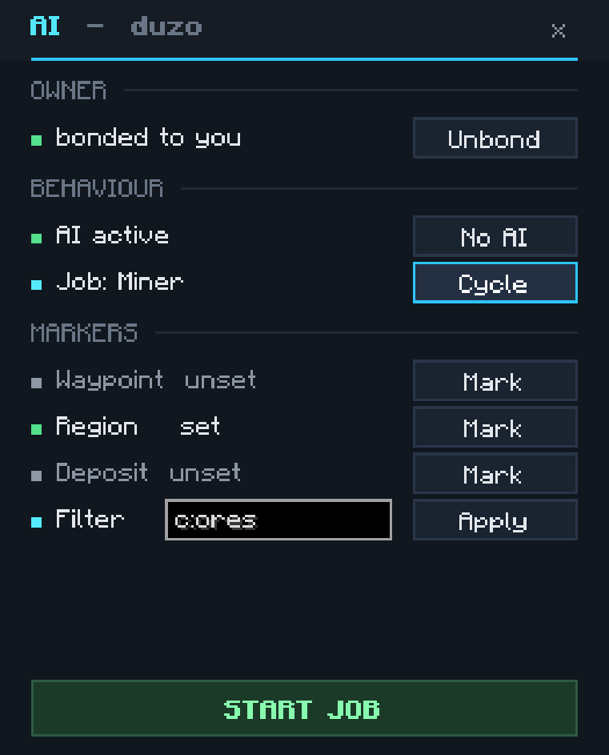 <b>AI sub-menu</b></td>
    <td align="center" valign="top">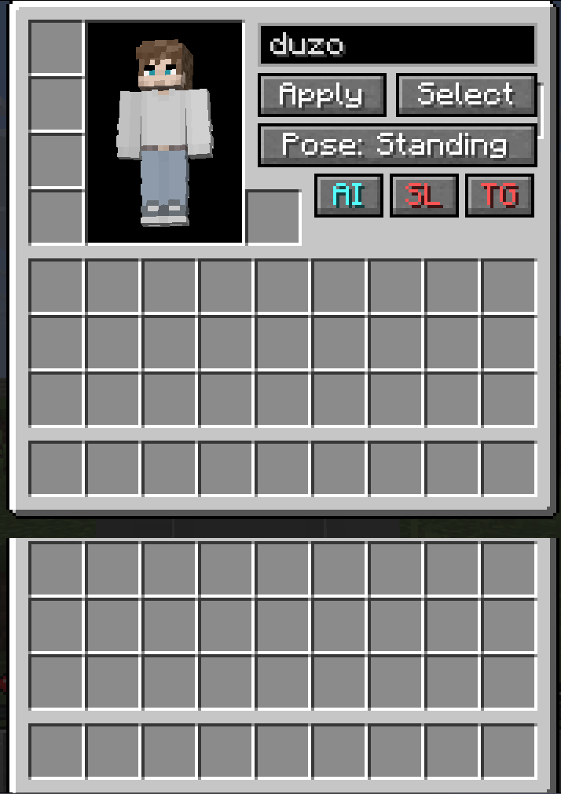 <b>Management GUI</b></td>
  </tr>
  <tr>
    <td align="center" valign="top">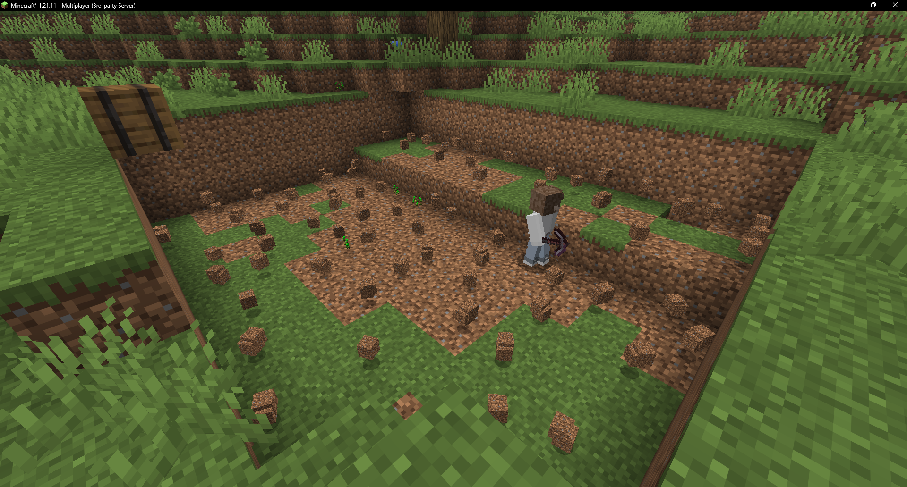 <b>Miner</b> clearing a quarry</td>
    <td align="center" valign="top">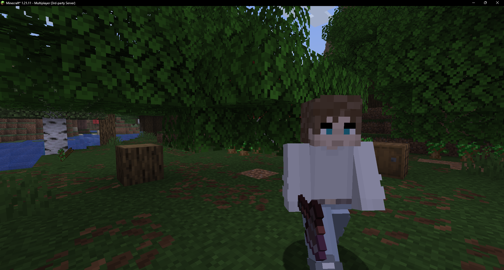 <b>Lumberjack</b> after felling a tree</td>
  </tr>
  <tr>
    <td align="center" valign="top">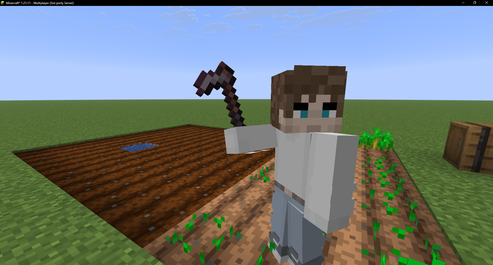 <b>Farmer</b> tending a watered plot</td>
    <td align="center" valign="top">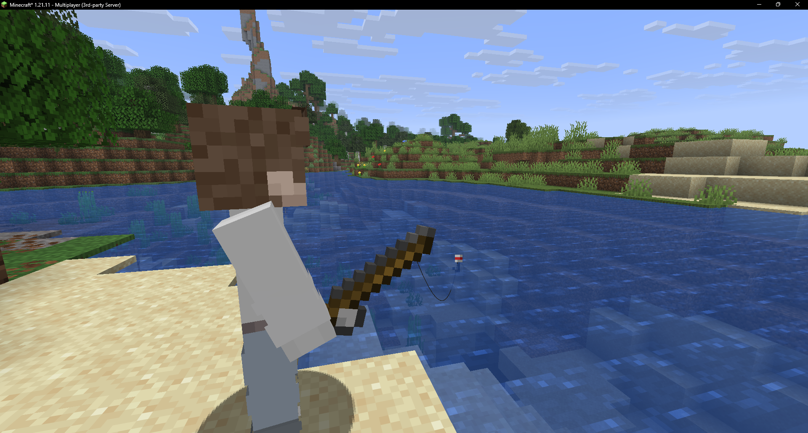 <b>Fisherman</b> casting at the water's edge</td>
  </tr>
  <tr>
    <td align="center" valign="top">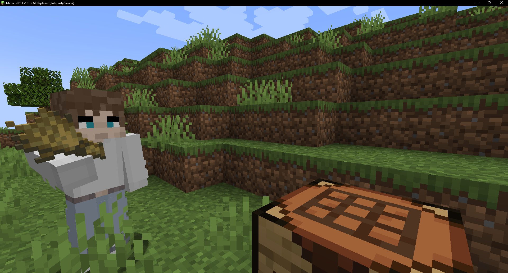 <b>Crafter</b> crafting by hand at its table</td>
  </tr>
</table>

## Skins

Name a fake after a player and it wears their skin - always matching. Also:

- **URL** - `/players url <entity> <url>`
- **Trending** - browse and apply from the in-game list (shift + right-click).
- **Slim & classic** both supported.

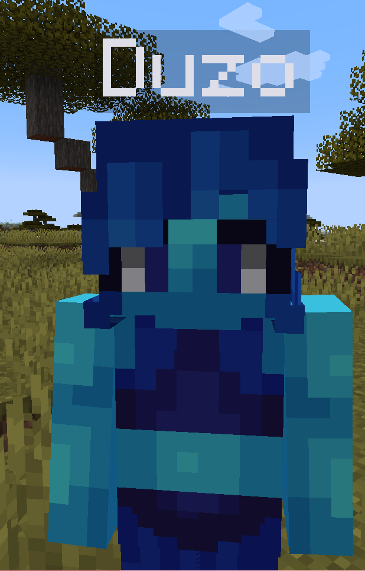

## Get one

Craft a `Robot Shell` and a `Robot AI`, then combine them in a crafting table for a `Player Egg`. Place it and the fake is already yours.

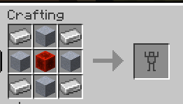
&nbsp;&nbsp;
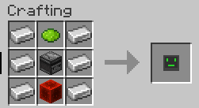
&nbsp;&nbsp;
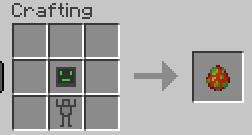

## Links

- [CurseForge](https://www.curseforge.com/minecraft/mc-mods/fake-player)
- [Modrinth](https://modrinth.com/mod/fake-players)
- [Discord](https://discord.gg/ZgssqpUMHS)
- [Showcase video](https://www.youtube.com/watch?v=O5BO6fA41n0)

## Credits

- [Jeryn](https://modrinth.com/user/Jeryn/) - skin API and downloading code.
